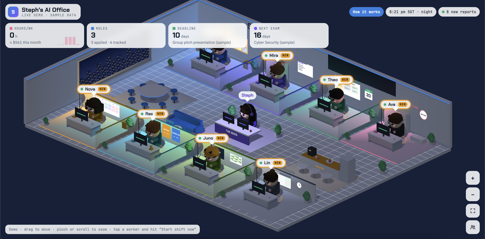

# AI Office

An office of AI agents that runs my student life, shown as a 3D office you can walk around in.

Eight Claude agents each own one job. They run on schedules in the cloud, share one database, read each other's work, and report back to a Three.js office where I can read their reports, give them instructions, or start a shift on demand.

**[Live demo](https://stephaniewee.github.io/ai-office/)** · runs in the browser with sample data, no login needed.



## The team

| Worker | Job | Runs |
|---|---|---|
| Kai · Job Scout | Finds full-time grad and Management Associate roles, tracks my application pipeline | Weekly |
| Mira · Study Buddy | Writes playable 8-question quizzes on only the topics I switch on, targets my weak spots, quizzes more often before exams | Weekly, twice a week before exams |
| Theo · Project PM | Tracks group-project deadlines and my part, suggests this week's focus | Weekly |
| Ava · Hours & Pay | Logs my part-time retail shifts and estimates pay | Weekly |
| Nova · Weekly Planner | Builds a Mon–Sun plan from everyone else's data | Weekly |
| Rex · Event Scout | Finds hackathons, meetups and career fairs in Singapore | Weekly |
| Juno · Portfolio Polisher | Picks one project a week: paste-ready intro, resume bullets, one upgrade | Weekly |
| Lin · Availability Helper | Works out which weekends I can work and drafts the message to my manager | Monthly |

Plus a Sunday digest that sums up the whole week.

## How it works

```
Scheduled Claude agents  ⇄  Shared document DB  ⇄  3D office (Three.js)
(cron, web search, DB)      (workers, jobs,         (live snapshots, reports,
                             events, quizzes,        instructions, "Ask the office")
                             shifts, orders)
```

- **Scheduled agents.** Each worker is a Claude agent on a cron schedule with its own instructions. A shift follows the same protocol: clock in (status → working), read pending instructions, do the job, write the report and structured data, clock out.
- **Shared state.** Everything lives in one document database. Agents read each other's output, so the planner can combine deadlines, shifts, quiz weak spots and events into one plan.
- **Human in the loop.** In the office I set job statuses (Saved, Applied, Interview), switch quiz topics on or off, mark events as Going or Skip, log shifts, and leave notes. Agents pick those up next shift and never overwrite my choices.
- **On-demand runs.** "Start shift now" fires the agent immediately through an MCP connector, optionally with a one-off instruction.
- **Ask the office.** A question box that sends the office's data to Claude and answers things like "Am I free on Saturday the 8th?"
- **Live UI.** The page subscribes to the database. Workers animate while they work, walk to a debrief table when they finish, and show a NEW badge until I read the report.

## Stack

Claude (scheduled agents, MCP tool calls, sampling) · Three.js · vanilla JavaScript · document database with live snapshots

## What I learned

- Designing agent protocols that are safe to re-run: idempotent writes, version-pinned updates, never leaving a status stuck on "working"
- Splitting work between agents and humans: agents propose, I decide (statuses, topics, events)
- Keeping agent output structured (quiz JSON, job and event records) so the UI can make it interactive rather than just showing text
- Managing cost: weekly schedules, conditional runs (extra quizzes only near exams), one digest instead of eight notifications

## Demo

`ai-office-demo.html` is a self-contained copy of the office with sample data and simulated agents. Open it in a browser or host it anywhere (Vercel, GitHub Pages). Three.js and fonts load from public CDNs.
